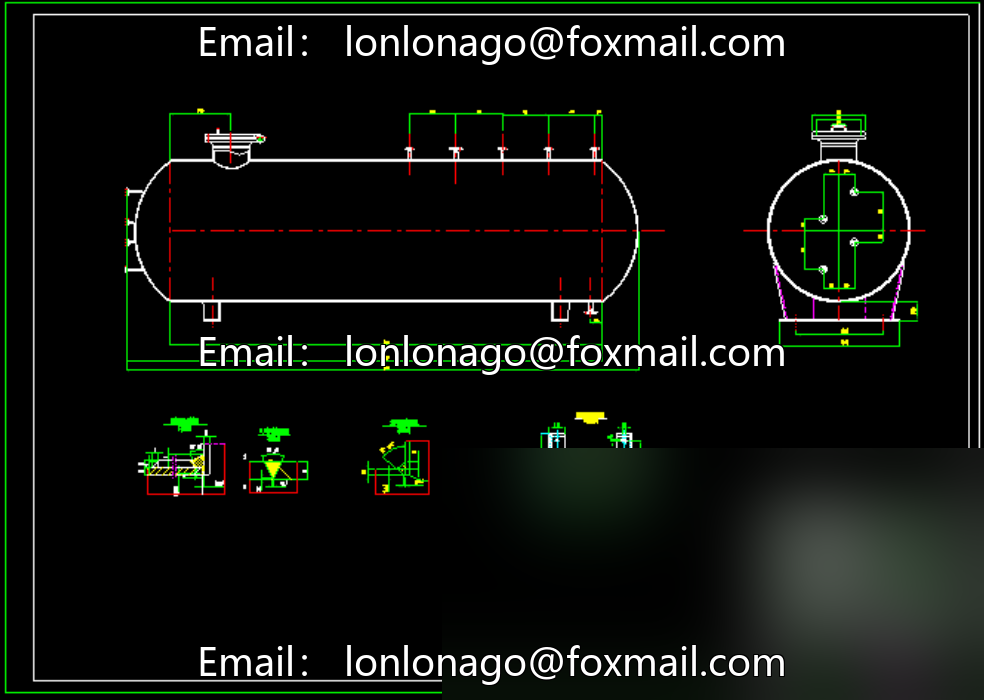
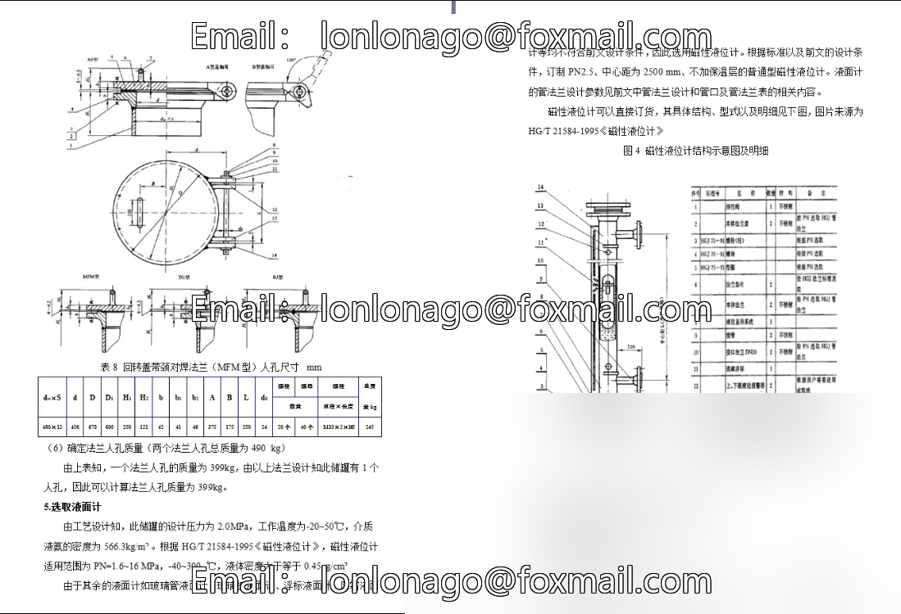
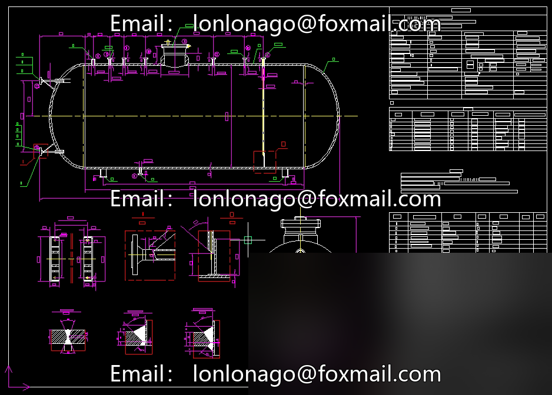

# Liquid ammonia storage tank design CAD material

## Body

Liquid ammonia tank design CAD materials 541 Liquid ammonia tank design liquid ammonia tank design diagram liquid ammonia tank design CAD diagram
This material contains two sets of liquid ammonia tank design reference materials, including CAD diagrams and instructions

The material provides liquid ammonia tank design references and CAD diagrams, covering design tasks, material and structural choices, calculations, pressure test and strength verification, and parameters for magnetic liquid level gauges and pipe flanges.

<!-- AI_ENRICHED -->

## Images

## Payment

Here is a pay link on Stripe ( https://buy.stripe.com/3cs8yP7sY87d0vu9AB ). Please contact me lonlonago@foxmail.com after funding $89, and I will send you a complete data files , thank you!

